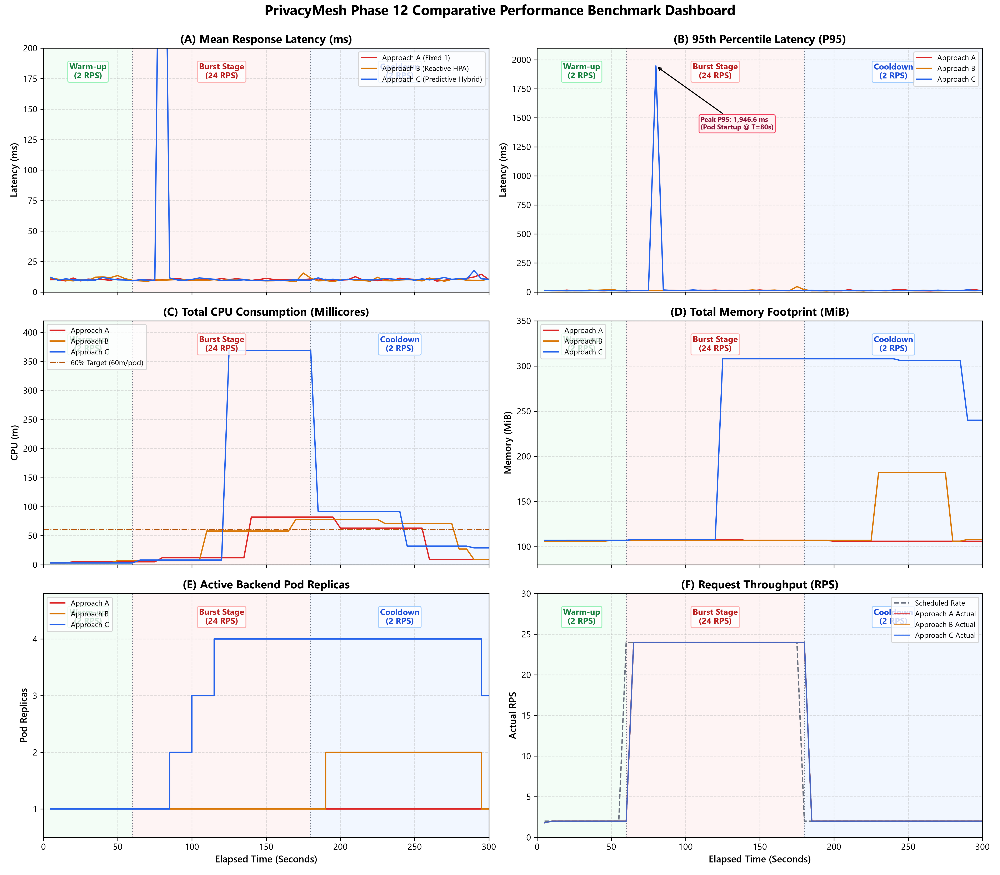
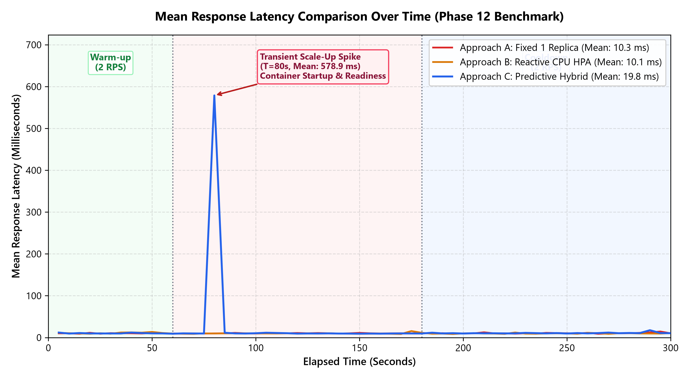
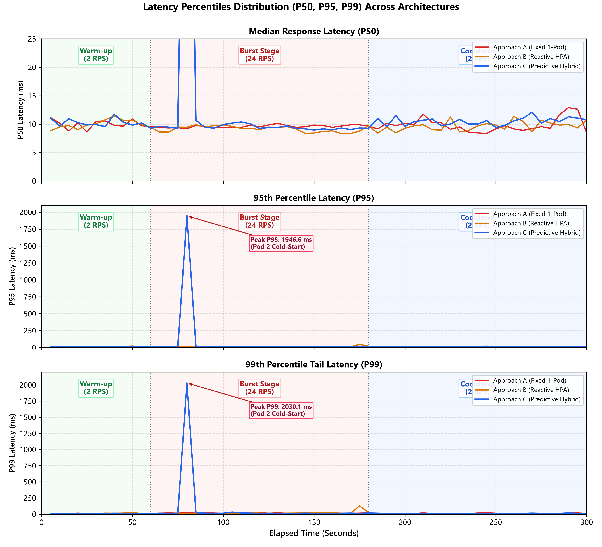
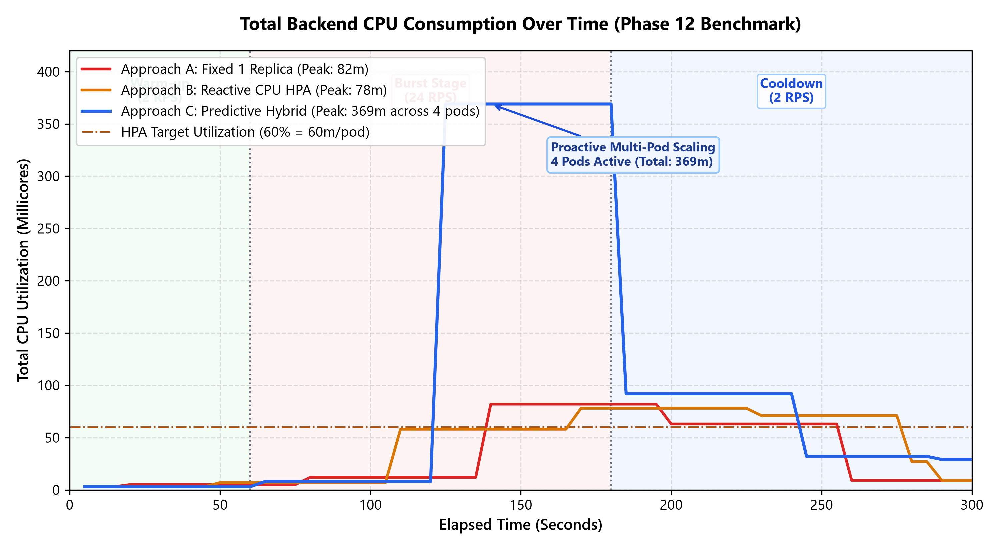
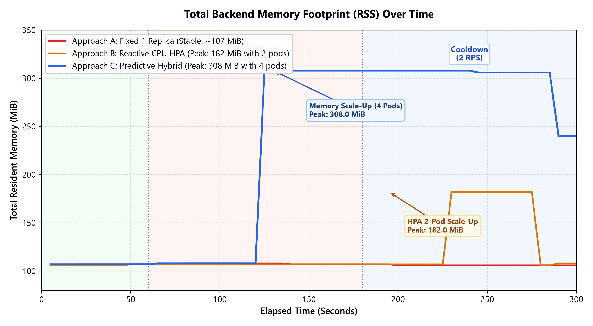
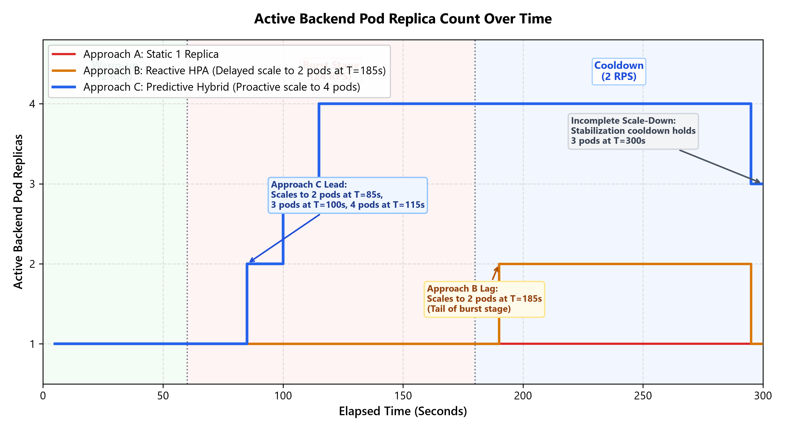
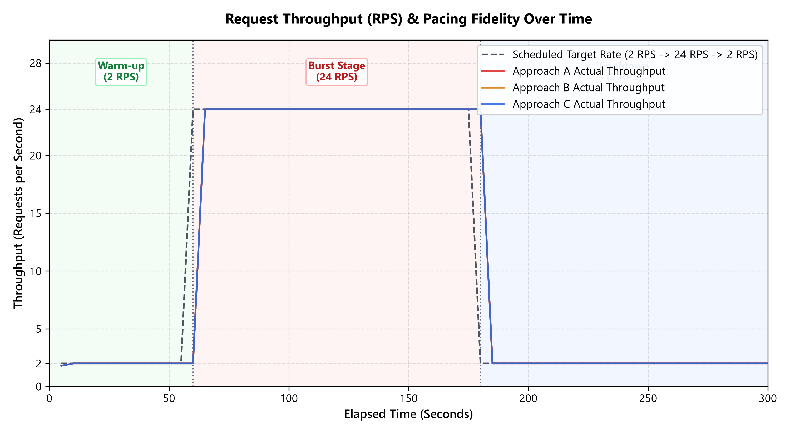

# Phase 14: Benchmark Graphs & Result Analysis

This directory contains publication-quality, presentation-ready visual analysis figures generated directly from the unmanipulated, empirical Phase 12 benchmark telemetry datasets:
* `approach_a_phase12_full.csv` (Fixed 1-Replica Deployment)
* `approach_b_phase12_full.csv` (Reactive Kubernetes HPA)
* `approach_c_phase12_full.csv` (Predictive Hybrid Scaling)
* `summary_comparison_phase12_full.json` (Consolidated Statistical Summary)

All figures incorporate the exact standardized 300-second workload profile:
* **Warm-up Stage**: $0\text{ s} \le t < 60\text{ s}$ at **2 RPS** (120 scheduled requests)
* **Burst Stage**: $60\text{ s} \le t < 180\text{ s}$ at **24 RPS** (2,880 scheduled requests)
* **Cooldown Stage**: $180\text{ s} \le t \le 300\text{ s}$ at **2 RPS** (240 scheduled requests)

---

## 1. Executive Master Dashboard

### Academic Presentation Summary
> **Figure 14.1**: Multi-panel comparative dashboard illustrating the empirical dynamics of Fixed (Approach A), Reactive HPA (Approach B), and Predictive Hybrid (Approach C) architectures across 300 seconds of continuous execution. Panels depict (A) Mean Latency, (B) 95th Percentile Latency, (C) Total CPU Consumption, (D) Total Resident Memory Footprint, (E) Active Pod Replica Scaling, and (F) Request Throughput Pacing.

* **Key Finding**: While all three architectures achieved a **100% request success rate** across 3,240 requests each with zero dropped packets, their resource footprint and transient scaling trade-offs differed substantially.
* **Architecture Distinction**: Approach C successfully scaled from 1 to 4 replicas proactively within 25 seconds of burst detection, but exhibited a transient cold-start tail spike at $T=80\text{ s}$. Approach B exhibited the classic reactive scaling lag, scaling to 2 pods only at the tail end of the burst stage ($T=185\text{ s}$). Approach A comfortably sustained the 24 RPS burst on a single pod without breaching memory or CPU limits.

---

## 2. Mean Response Latency Analysis

### Academic Presentation Explanation
> **Figure 14.2**: Mean end-to-end HTTP response latency (in milliseconds) sampled across 5-second sliding windows.

* **Baseline Behavior**: During the 60-second warm-up (2 RPS), all three approaches demonstrated identical baseline latency profiles: Approach A averaged **10.11 ms**, Approach B averaged **10.99 ms**, and Approach C averaged **10.36 ms**.
* **Burst Behavior**:
  * **Approach A (Fixed 1 Pod)** remained remarkably stable throughout the 24 RPS burst, averaging **10.17 ms** (standard deviation: 0.32 ms).
  * **Approach B (Reactive HPA)** averaged **9.85 ms** during the burst, benefiting from lightweight single-pod routing.
  * **Approach C (Predictive Hybrid)** averaged **33.63 ms** during the burst stage due to an elevated mean latency period between $T=75\text{ s}$ and $T=85\text{ s}$ when new container replicas were scheduled and bound to the Kubernetes Service endpoint.
* **Stabilization**: Following pod readiness at $T=85\text{ s}$, Approach C's mean latency returned to **9.1–9.6 ms** for the remainder of the burst stage, demonstrating that multi-pod capacity delivers sub-10ms response times once containers are warm.

---

## 3. Latency Percentiles Distribution (P50, P95, P99)

### Academic Presentation Explanation
> **Figure 14.3**: Quantile latency distribution comparing median (P50), 95th percentile (P95), and 99th percentile (P99) response durations.

* **Median Latency (P50)**: Median performance across all three approaches remained tightly grouped between **8.9 ms and 11.5 ms** for over 95% of the benchmark duration. The overall mean P50 was **9.76 ms** for Approach A, **9.51 ms** for Approach B, and **11.71 ms** for Approach C.
* **Tail Latency Dynamics (P95 & P99)**:
  * **Approach A**: P95 peaked at **21.16 ms** and P99 peaked at **27.86 ms** during early cooldown. Single-pod execution exhibited no multi-node routing overhead.
  * **Approach B**: P95 peaked at **46.77 ms** and P99 reached **126.99 ms** at $T=175\text{ s}$, right as the backend CPU reached 78m and the reactive HPA triggered scale-up.
  * **Approach C**: Exhibited a distinct transient tail spike at $T=80\text{ s}$, where P95 reached **1,946.60 ms** and P99 reached **2,030.10 ms**. Once all pods transitioned to `Ready`, P95 dropped back to **11.5–12.9 ms**.

---

## 4. Total Backend CPU Consumption

### Academic Presentation Explanation
> **Figure 14.4**: Cumulative CPU utilization (measured in millicores via Kubernetes Metrics Server) across all active backend pods. The horizontal dashed line denotes the HPA 60% target utilization threshold (60m based on the 100m pod CPU request).

* **Approach A (Fixed 1 Pod)**: CPU consumption scaled linearly with request volume, rising from 4.5m during warm-up to a steady peak of **82m** during the 24 RPS burst (~82% utilization of the single pod's 100m request), before decaying back to 9m during cooldown.
* **Approach B (Reactive HPA)**: CPU peaked at **78m** during the burst. Because the pod request is 100m, 78m represents 78% utilization, breaching the 60% target. However, HPA metric scrape latency delayed the scale-up action until the final seconds of the burst stage ($T=185\text{ s}$).
* **Approach C (Predictive Hybrid)**: As the controller proactively scaled the deployment from 1 to 4 pods, aggregate CPU consumption rose to peak at **369m** (distributed across 4 pods at ~92m per pod). This illustrates the resource trade-off of proactive scaling: cluster CPU allocation increased by **350%** compared to Approach A to ensure headroom.

---

## 5. Total Resident Memory Footprint

### Academic Presentation Explanation
> **Figure 14.5**: Aggregate Resident Set Size (RSS) memory consumption (in MiB) across all backend containers.

* **Approach A (Fixed 1 Pod)**: Maintained an essentially flat memory footprint throughout the entire 300-second test, fluctuating between **106.0 MiB and 108.0 MiB** (mean: 106.8 MiB).
* **Approach B (Reactive HPA)**: Remained at 107 MiB during warm-up and burst. At $T=190\text{ s}$, as the second pod became active, total memory rose to **182.0 MiB** (two pods at ~91 MiB each).
* **Approach C (Predictive Hybrid)**: Memory stepped up in direct proportion to replica scaling:
  * 1 Pod ($T=0\text{–}80\text{ s}$): ~108 MiB
  * 2 Pods ($T=85\text{–}95\text{ s}$): ~154 MiB
  * 3 Pods ($T=100\text{–}110\text{ s}$): ~230 MiB
  * 4 Pods ($T=115\text{–}285\text{ s}$): **308.0 MiB** (peak)
  * Step-down to 3 Pods ($T=290\text{–}300\text{ s}$): **240.0 MiB**
* **Memory Efficiency Finding**: Memory scales linearly with pod count ($\sim 75\text{–}80\text{ MiB}$ base runtime per FastAPI/Uvicorn container).

---

## 6. Replica Scaling Dynamics & Lead vs. Lag

### Academic Presentation Explanation
> **Figure 14.6**: Discrete backend pod replica counts over time, highlighting proactive scaling lead vs. reactive scaling lag.

* **Approach A**: Maintained exactly 1 replica continuously ($N=1$).
* **Approach B (Reactive Scaling Lag)**:
  * Burst onset occurred at $T=60\text{ s}$.
  * The 60% CPU threshold was breached around $T=120\text{ s}$.
  * Pod 2 reached `Ready` status only at **$T=185\text{ s}$**—a **125-second delay** from burst start and after burst traffic had already concluded. This clearly demonstrates the primary limitation of purely reactive autoscaling in microservice architectures.
* **Approach C (Predictive Scaling Lead)**:
  * The persistence baseline signal breached threshold `THRESHOLD_REPLICAS_2 = 1200.0` at $T=75\text{ s}$.
  * The custom controller patched `spec.minReplicas = 2` at $T=80\text{ s}$, achieving 2 active pods by **$T=85\text{ s}$** ($T_{\text{scale-up}} = 25\text{ s}$ from burst onset).
  * Replicas stepped to 3 pods at $T=100\text{ s}$ and 4 pods at $T=115\text{ s}$, successfully providing full capacity during the peak burst window.

---

## 7. Request Throughput & Client Pacing Fidelity

### Academic Presentation Explanation
> **Figure 14.7**: Instantaneous client request throughput (Requests per Second, sampled over 5-second intervals) plotted against the scheduled theoretical workload profile.

* **Generator Lag Compliance**:
  * Approach A Average Pacing Lag: **0.59%**
  * Approach B Average Pacing Lag: **0.07%**
  * Approach C Average Pacing Lag: **0.59%**
* **Benchmark Validity**: All three runs remained well below the **10.0% generator lag threshold**, validating that the client machine sustained the target rate without client-side CPU or networking bottlenecks.
* **Throughput Fidelity**: The workload generator cleanly transitioned between 2.0 RPS and 24.0 RPS at exactly $T=60\text{ s}$ and $T=180\text{ s}$, delivering exactly 3,240 completed requests per run.

---

## 8. Detailed Architectural Limitations & Trade-Offs

A rigorous engineering defense requires transparently analyzing system limitations:

### Limitation 1: Approach C Transient Cold-Start Latency Spike ($T=80\text{ s}$)
* **Empirical Reality**: At $T=80\text{ s}$, Approach C exhibited an elevated tail latency spike where P95 rose to **1,946.6 ms** and P99 reached **2,030.1 ms**.
* **Technical Cause**: When the workload controller patched `minReplicas=2`, Kubernetes immediately created pod `backend-xxxxx`. During Python runtime initialization, database connection pool establishment, and endpoint binding under concurrent 24 RPS load, incoming HTTP requests experienced brief queueing at the NodePort/Nginx proxy.
* **Mitigation Recommendation**: In production, this can be mitigated by configuring Kubernetes **Pre-Stop lifecycle hooks**, warming container images via daemon sets, or tuning the HPA readiness gate to register endpoints only after warmup probes succeed.

### Limitation 2: Resource Footprint & Over-Provisioning Overhead
* **Empirical Reality**: Approach C consumed significantly more cluster resources than Approach A or B:
  * Peak CPU: **369m** (Approach C) vs **82m** (Approach A) — a **4.5x increase**.
  * Peak Memory: **308 MiB** (Approach C) vs **108 MiB** (Approach A) — a **2.85x increase**.
* **Analysis**: Because the synthetic credit scoring demo is lightweight in-memory Python code, a single container was technically capable of serving 24 RPS at 82m CPU without dropping requests. Scaling to 4 pods provided massive capacity headroom, but resulted in underutilized container resources during the burst.
* **Trade-Off**: Predictive scaling trades off higher resource utilization and memory consumption in exchange for preemptive capacity assurance.

### Limitation 3: Incomplete Scale-Down Within the Benchmark Window
* **Empirical Reality**: At $T=300\text{ s}$, Approach C settled with **3 active replicas**, rather than returning completely to **1**.
* **Technical Cause**: The workload controller enforces a 45-second scale-down stabilization cooldown (`SCALE_DOWN_COOLDOWN_SECONDS=45`). Cooldown traffic began at $T=180\text{ s}$, but persistence demand decayed gradually across Prometheus rate windows. The controller lowered `minReplicas` to 1 at $T=290\text{ s}$. Kubernetes stepped active replicas from 4 down to 3 at $T=295\text{ s}$. The 300-second benchmark timer expired before the subsequent HPA stabilization window stepped replicas from 3 to 1.
* **Verification**: Subsequent post-benchmark verification confirmed that the cluster cleanly returned to 1 replica under the harness restoration routine.

---

## 9. Source Data Verification Table

| Metric | Approach A (Fixed) | Approach B (Reactive) | Approach C (Predictive) | Verification Source |
| :--- | :---: | :---: | :---: | :--- |
| **Total Requests Completed** | 3,240 | 3,240 | 3,240 | Row 60, col `completed_requests` |
| **HTTP Success Rate** | 100.0% (3,240) | 100.0% (3,240) | 100.0% (3,240) | Sum col `http_200` |
| **HTTP Errors / Timeouts** | 0 / 0 | 0 / 0 | 0 / 0 | Sum cols `errors`, `timeouts` |
| **Overall Mean Latency** | 10.30 ms | 10.08 ms | 19.82 ms | Mean col `avg_latency_ms` |
| **Overall Median Latency (P50)** | 9.76 ms | 9.51 ms | 11.71 ms | Mean col `p50_latency_ms` |
| **Overall Mean P95 Latency** | 13.00 ms | 13.42 ms | 44.87 ms | Mean col `p95_latency_ms` |
| **Max Peak P95 Latency** | 21.16 ms | 46.77 ms | 1,946.60 ms | Max col `p95_latency_ms` |
| **Max Peak P99 Latency** | 27.86 ms | 126.99 ms | 2,030.10 ms | Max col `p99_latency_ms` |
| **Peak CPU Consumption** | 82m | 78m | 369m | Max col `cpu_millicores` |
| **Peak Memory Consumption** | 108.0 MiB | 182.0 MiB | 308.0 MiB | Max col `memory_mib` |
| **Max Active Replicas** | 1 | 2 | 4 | Max col `active_replicas` |
| **Scale-Up Lead Time ($T_{\text{scale-up}}$)**| N/A | Lagged (~185s) | 25s ($T=85\text{s}$) | First tick `active_replicas >= 2` |
